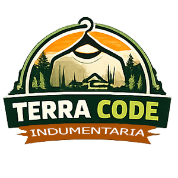
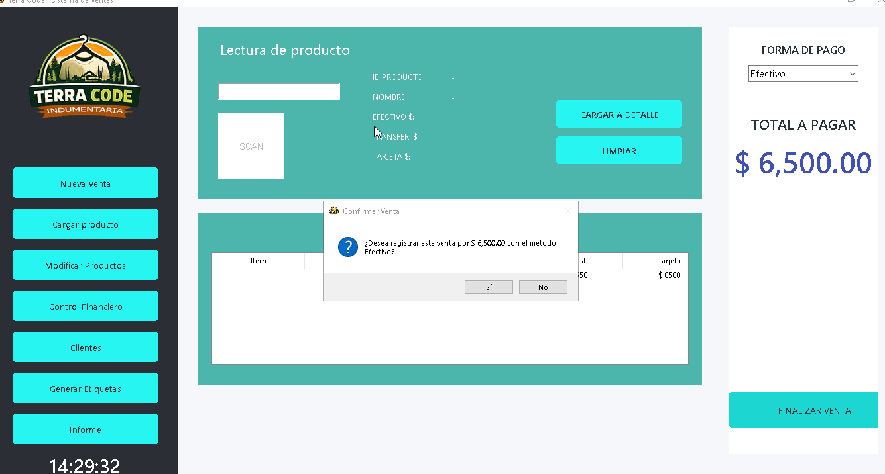
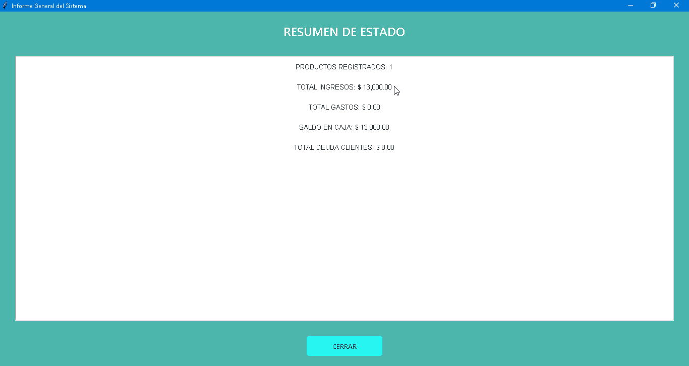
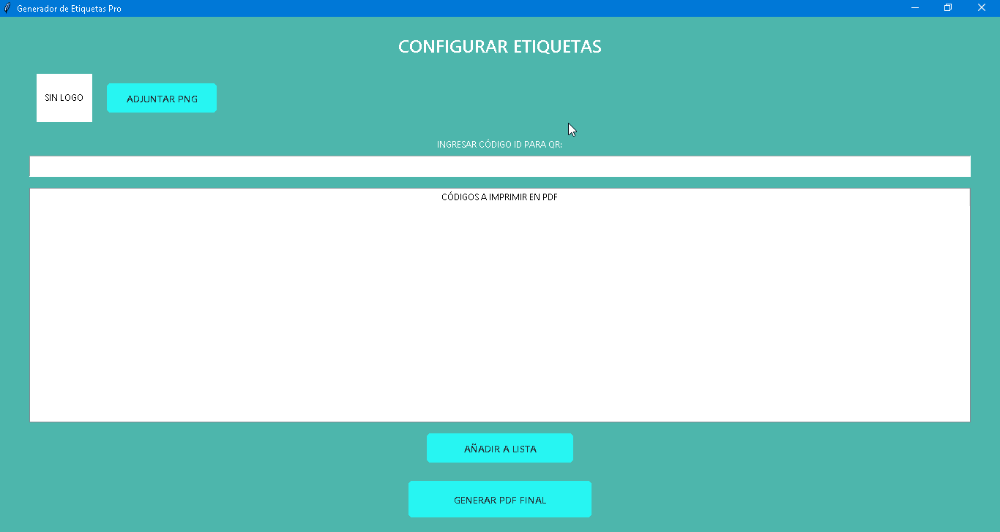
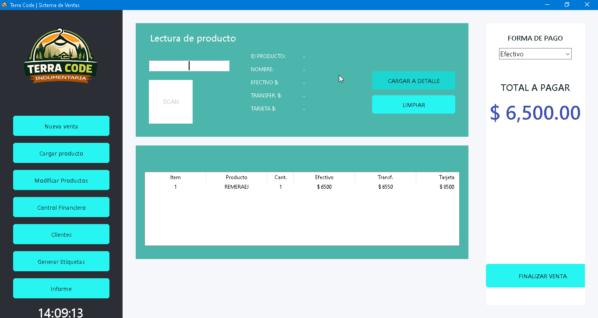

<p align="center">
  
</p>

<h1 align="center">TerraCodeTienda — Landing Web</h1>

<p align="center">
  <strong>Página web y presentación interactiva del software de gestión comercial, punto de venta (POS) y control de stock con códigos QR para tiendas de indumentaria.</strong>
</p>

<p align="center">
  
  
  
  
  
  
</p>

---

## 📌 Tabla de Contenidos

- [Sobre el Proyecto](#-sobre-el-proyecto)
- [Características del Software](#-características-del-software)
- [Capturas de Pantalla](#-capturas-de-pantalla-reales)
- [Video Demostrativo](#-video-demostrativo)
- [Requisitos Técnicos](#-requisitos-técnicos)
- [Estructura del Repositorio](#-estructura-del-repositorio)
- [Cómo visualizar el proyecto](#-cómo-visualizar-el-proyecto)
- [Buenas Prácticas y Seguridad Implementadas](#-buenas-prácticas-y-seguridad-implementadas)
- [Autor y Contacto](#-autor-y-contacto)
- [Licencia](#-licencia)

---

## 📖 Sobre el Proyecto

**TerraCodeTiendaWeb** es la plataforma web de aterrizaje (landing page) desarrollada para presentar y exhibir las funcionalidades de **TerraCodeTienda**, una solución de software integral concebida para satisfacer las necesidades operativas de comercios de indumentaria, ropa y calzado.

El sitio está diseñado siguiendo la identidad visual de marca (*TerraCode Identity*), combinando tonos verde bosque oscuro, acentos verde lima y toques terracota, con efectos de glassmorphism, animaciones fluidas, visor modal (lightbox) para imágenes y reproductor de video nativo para demostraciones en tiempo real.

---

## ✨ Características del Software

El sistema comercial **TerraCodeTienda** destaca por los siguientes pilares:

- 🛒 **Módulo de Caja (Punto de Venta - POS):**
  - Búsqueda ágil de prendas por código o descripción.
  - Gestión multimoneda y compatibilidad con **Efectivo**, **Transferencia** y **Fiado / Cuentas Corrientes**.
  - Configuración de recargos, intereses por cuotas y prefijos de artículos (ej: `REM-`, `PAN-`).
  - Confirmaciones de seguridad antes de procesar cada operación para evitar cobros involuntarios.
  - Emisión de tickets y resúmenes instantáneos.

- 🏷️ **Inventario y Códigos QR:**
  - Generación dinámica e impresión de códigos QR por producto para escaneo rápido con lector de código de barras / QR.
  - Validación de stock en tiempo real con alertas de existencias bajas.
  - Categorización jerárquica de inventario.

- 💾 **Persistencia Confiable en Excel & Copias de Seguridad:**
  - Almacena toda la información de transacciones y stock en hojas de cálculo de Microsoft Excel legibles y transparentes.
  - Sistema de **backup automático** antes de cada guardado en la carpeta `backups/`.

- ⚡ **Portabilidad y Modo Offline Total:**
  - Distribuido como ejecutable único (`.exe`) sin dependencias externas pesadas.
  - Se puede transportar en un pendrive y utilizar en cualquier computadora sin necesidad de conexión a internet ni configuración de servidores SQL externos.

---

## 📸 Capturas de Pantalla Reales

A continuación se muestran capturas de la interfaz y los módulos del sistema:

| **Módulo de Caja (POS)** | **Resumen y Balances de Venta** |
| :---: | :---: |
|  |  |
| *Buscador ágil, cálculo automático de importes y selección de medios de pago.* | *Visualización y control de ingresos por día, mes y método de cobro.* |

<br/>

| **Generador de Códigos QR e Inventario** | **Video Demostrativo / Vista Previa** |
| :---: | :---: |
|  |  |
| *Etiquetado automático de prendas con código QR listo para imprimir.* | *Demostración del software en funcionamiento integrado en el reproductor.* |

---

## 🎬 Video Demostrativo

La web incorpora un visor interactivo que reproduce un video demostrativo (`images/Demo.mp4`) en pantalla completa o modal cuando el usuario hace clic sobre la vista previa:

```
[▶ Reproducir Demo] -> Abre modal con controles nativos y reproducción fluida.
```

---

## 💻 Requisitos Técnicos

Para el despliegue del software de escritorio exhibido en la página:

- **Sistema Operativo:** Windows 7, Windows 10, Windows 11 (x64).
- **Memoria RAM:** 4 GB mínimo.
- **Espacio en Disco:** 200 MB disponibles.
- **Software Complementario:**
  - Microsoft Excel (opcional, para visualización directa de planillas).
  - Lector de PDF (para visualización de reportes generados).

---

## 📁 Estructura del Repositorio

```text
TerraCodeTiendaWeb/
│
├── images/
│   ├── Caja.png                # Captura de pantalla del módulo de caja POS
│   ├── Demo.mp4                # Video demostrativo en alta definición
│   ├── imgQR.png               # Captura del generador de códigos QR
│   ├── ImgVideo.png            # Miniatura / preview para el reproductor de video
│   ├── logo_indumentaria.png   # Isologotipo oficial de TerraCodeTienda
│   └── Resumen.png             # Captura del panel de resumen y métricas
│
├── .gitattributes              # Normalización automática de saltos de línea LF/CRLF
├── .gitignore                  # Exclusión de archivos de sistema, logs y respaldos
├── index.html                  # Landing page interactiva (HTML5 + CSS3 + JS Vanilla)
├── LICENSE                     # Licencia de código abierto MIT
└── README.md                   # Documentación oficial del repositorio
```

---

## 🚀 Cómo visualizar el proyecto

### 1. Clonar el repositorio
```bash
git clone https://github.com/Lurdciano/TerraCodeTiendaWeb.git
cd TerraCodeTiendaWeb
```

### 2. Abrir en el navegador
No requiere instalación de dependencias, Node.js ni compilación previa. Puede abrirse directamente:

- **Doble clic** sobre el archivo `index.html`.
- O utilizando extensiones locales como **Live Server** en Visual Studio Code.
- O mediante un servidor HTTP local en Python:
  ```bash
  python -m http.server 8000
  ```
  Luego ingresar a `http://localhost:8000` en tu navegador.

---

## 🛡️ Buenas Prácticas y Seguridad Implementadas

La landing page `index.html` incluye cabeceras de seguridad y optimizaciones:
- **Content Security Policy (CSP):** Restricción estricta de fuentes de scripts, estilos y contenido multimedia.
- **Cabeceras HTTP de protección:** `X-Content-Type-Options: nosniff`, `X-Frame-Options: DENY`, `X-XSS-Protection: 1; mode=block`, `Referrer-Policy: strict-origin-when-cross-origin`.
- **Open Graph y Twitter Cards:** Metadatos configurados para previsualizaciones al compartir en redes sociales y mensajería.
- **Accesibilidad y Responsive Design:** Interfaz adaptada a dispositivos móviles, tablets y monitores de escritorio.
- **Copiar correo interactivo:** Botón con validación regex y fallback al portapapeles.

---

## 👤 Autor y Contacto

**Luciano Ruiz Diaz**  
*Desarrollador de Software · Creador de TerraCode*

- 📧 **Correo Electrónico:** [lurdciano@gmail.com](mailto:lurdciano@gmail.com)
- 💼 **LinkedIn:** [luciano-ruizdiaz](https://www.linkedin.com/in/luciano-ruizdiaz)
- 🐙 **GitHub:** [@Lurdciano](https://github.com/Lurdciano)
- 🌐 **Sitio Web Oficial:** [terracode.com.ar](https://terracode.com.ar/)

---

## 📄 Licencia

Este proyecto está distribuido bajo los términos de la licencia **MIT**. Para más detalles, consulta el archivo [LICENSE](LICENSE).
